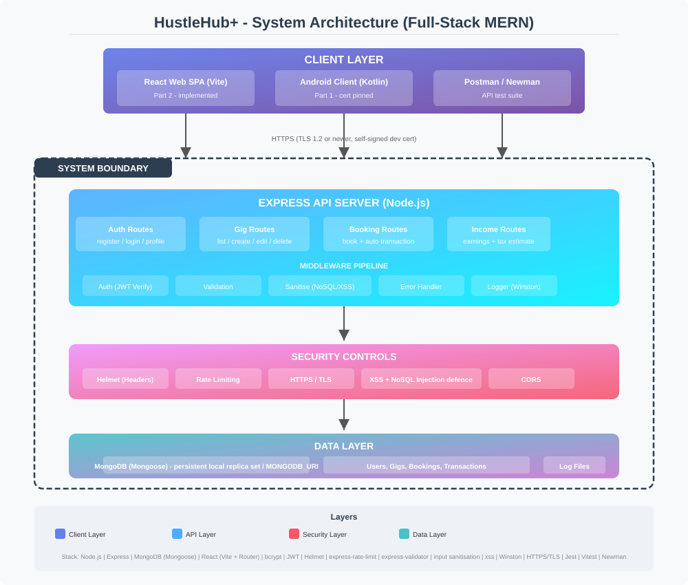

# HustleHub+ - Part 2

HustleHub+ is a MERN freelance marketplace. Freelancers publish and manage their own gigs; clients browse and book them. Each confirmed booking records a simulated payment and contributes to the correct freelancer's income dashboard.

## Submission artefacts

- **Part 2 demonstration video:** [HustleHubPlus Part 2 demo](https://youtu.be/iptm8ebDpxw).
- **Postman collection:** [HustleHub+ Postman Collection.json](HustleHub%2B%20Postman%20Collection.json).
- **Test evidence:** [docs/evidence](docs/evidence/), including Newman XML and console output.
- **Application screenshots:** [screenshot index](docs/screenshots/README.md).
- **MERN architecture:** [architecture-diagram.svg](architecture-diagram.svg).

## Users and application flow

| Role | Access |
| --- | --- |
| Client | Register/login, browse gigs, book available gigs, view own bookings |
| Freelancer | Create/edit/remove own listings, view bookings on own gigs, view own income and transactions |
| Admin | Reserved database role; cannot be self-assigned at registration; can inspect bookings through the API |

Public gig browsing and details show service information and the freelancer's name. Private bookings and financial information require authentication. Public registration accepts only client or freelancer.

A client books an active gig at its current price. A MongoDB transaction saves the booking and payment record together, or neither is saved. The server derives the price, freelancer and client from the gig and authenticated account, so clients cannot supply another user's identity or a different payment amount.

Deleting a listing removes it from public and owner listings. Existing booking and transaction records remain available, and earned income is retained. Booking and deletion contend on the same gig document, preventing a booking from being confirmed after the listing has become unavailable.

## Architecture and project layout



React runs in the browser. Express/Node serves both the built React app and the HTTPS API, with JWT, role/ownership checks, validation, sanitisation, rate limiting, Helmet/CSP, error handling and logging. Mongoose stores users, gigs, bookings and transactions in MongoDB. A local replica set uses persistent development storage; external production databases must support transactions.

```text
backend/
  server.js                 HTTPS startup and shutdown
  src/config/db.js          MongoDB connection and local replica set
  src/middleware/           JWT, roles, validation, sanitisation and errors
  src/models/               User, Gig, Booking and Transaction
  src/routes/               Auth, gigs, bookings and income
  scripts/                  TLS setup, safe demo seeding, smoke, Newman fixture
  tests/                    Seven backend suites
frontend/
  src/api/                  API wrapper and session rejection handling
  src/context/              Auth state and token lifecycle
  src/components/           Shared controls and protected navigation
  src/pages/                Marketplace, authentication and dashboards
  src/test/                 Seven frontend suites
scripts/                    Local setup and Postman collection generation
docs/evidence/              Recorded test/build/audit results
docs/screenshots/           Application screenshots
```

## Setup on a fresh PC

Use **Node.js 24 or newer**, npm and Git. Windows Git includes the OpenSSL binary used by the certificate generator. On other systems, install OpenSSL or set `OPENSSL_PATH`. Postman is useful for interactive API testing; Newman is installed with the backend's development dependencies.

From the repository root:

```powershell
npm run setup
npm start
```

`setup` installs the locked backend/frontend dependencies, creates an ignored `backend/.env` with a random JWT secret, generates a local HTTPS certificate if absent and builds React. Open **https://localhost:3443**. Run `npm run seed` in another terminal for sample data. Seeding is repeatable and preserves existing records; it is disabled for production.

| Demo role | Email | Password |
| --- | --- | --- |
| Freelancer | zane@hustlehub.demo | DemoPass1! |
| Freelancer | mia@hustlehub.demo | DemoPass1! |
| Client | alex@hustlehub.demo | DemoPass1! |

### Database and environment

Development automatically downloads and runs a local MongoDB replica set. The initial download can take several minutes. Database files live in ignored `backend/.mongo-data/db`, and records survive restarts. Default database port: 27018 (`MONGO_DEV_PORT` can change it). Close the backend with Ctrl+C before launching another instance.

`backend/.env.example` lists configuration. The server rejects a missing, short or placeholder signing secret. Never commit `.env`, certificate private keys, database files or logs.

For an external database, set `MONGODB_URI` to a replica-set/Atlas or sharded-cluster URI. A standalone MongoDB server does not support the required atomic booking transaction. `NODE_ENV=production` requires an external database. Use a trusted TLS certificate and a separate secret for production.

### Local certificate trust

The certificate covers localhost and 127.0.0.1. To trust your generated certificate for this Windows user:

```powershell
Import-Certificate -FilePath backend/certs/cert.pem -CertStoreLocation Cert:/CurrentUser/Root
```

Regenerate using `node backend/scripts/generate-cert.js`. Each developer generates their own private key. Do not reuse development certificates in production.

### Frontend development

Run the HTTPS backend, then:

```powershell
npm --prefix frontend run dev
```

Vite serves the development UI on http://localhost:5173 and proxies `/api` to the local HTTPS backend. This is a development convenience. The built app uses a single HTTPS origin on port 3443. `CORS_ORIGINS` permits explicitly listed development origins; production can serve the app from the backend's origin.

## API endpoints

| Method | Endpoint | Access |
| --- | --- | --- |
| GET | `/api`, `/api/health` | Public API information and health |
| POST | `/api/auth/register`, `/api/auth/login` | Public authentication; rate limited |
| GET | `/api/auth/profile` | Current authenticated database account |
| GET | `/api/gigs`, `/api/gigs/:id` | Public active listings/details |
| GET | `/api/gigs/mine` | Freelancer's own current listings |
| POST | `/api/gigs` | Freelancer |
| PUT / DELETE | `/api/gigs/:id` | Freelancer who owns the listing |
| POST | `/api/bookings` | Client; booking/payment saved atomically |
| GET | `/api/bookings` | Own bookings for clients; own gig bookings for freelancers; all for admin |
| GET | `/api/bookings/:id` | Related client/freelancer or admin |
| GET | `/api/income` | Freelancer's own transactions, earnings and tax estimate |

Search: `/api/gigs?query=logo&category=Design`. Search text is escaped for regular expressions. Responses use `{ status, message?, data? }`; controlled errors include `statusCode` and a message. Invalid input returns 400, unauthenticated requests 401, forbidden access 403, missing resources 404, duplicate registration 409 and throttled requests 429.

## Security decisions

- **Passwords:** bcrypt with 12 salt rounds; hashes are excluded from normal queries and responses. Passwords must be strings with at least 8 characters and uppercase/lowercase/number/symbol. Inputs above 72 UTF-8 bytes are rejected to prevent silent bcrypt truncation. Unknown-email login performs a dummy password comparison.
- **JWT:** HS256 only, issuer `hustlehub-plus`, audience `hustlehub-plus-api`, one-hour default expiry. Every protected request verifies the token and loads the current account/role from MongoDB. Deleted accounts and expired tokens are rejected.
- **RBAC and ownership:** clients can book; freelancers can manage their own gigs and view their own income. Ownership is enforced by the API and frontend navigation. Admin cannot register through the public API.
- **Validation:** credentials/text fields require correct types; IDs must be ObjectIds. Gig text and delivery days have bounds. Prices must be 1 to 1,000,000 with no more than two decimal places. Only explicitly extracted fields are persisted.
- **Sanitisation:** XSS tags/script bodies are stripped from text. NoSQL operator and prototype field names are rejected. React escapes content and does not render raw user HTML.
- **Rate limiting:** per-IP global API limit 100/15 minutes; authentication limit 10 failed requests/15 minutes (successful authentication does not consume that budget); booking creation limit 20 attempts/15 minutes. Responses include retry guidance. Limits are process-local and need a shared store for multiple server instances.
- **Headers:** Helmet sets CSP (`default-src 'self'`, scripts/connect only from self, no objects or embedding), HSTS, nosniff and other headers. Unexpected origins receive a controlled 403. Built app/API share one HTTPS origin.
- **Errors and logging:** malformed JSON, oversized bodies and unexpected failures return controlled messages. Stack traces stay in server logs. Logs capture authentication, resource changes, bookings and blocked access; the seeder does not print JWTs.
- **Financial records:** atomic booking/payment writes, unique booking-to-transaction association and retained history after listing removal. Totals aggregate integer cents. Tax is the project's simplified **15.3% flat estimate**, displayed as such; it is not a jurisdiction-specific tax model.
- **Web sessions:** tokens are in localStorage, with expiry checks and clearing on protected API 401 responses. CSP, sanitisation and escaped rendering reduce script-injection exposure; token storage should be reassessed for production.

## Tests and evidence

Verified on 12 October 2026 with Node.js 24.20.0:

| Check | Result | Evidence |
| --- | --- | --- |
| Backend Jest | 78 tests, 7 suites passed | [backend-tests.txt](docs/evidence/backend-tests.txt) |
| Frontend Vitest | 27 tests, 7 suites passed | [frontend-tests.txt](docs/evidence/frontend-tests.txt) |
| React production build | Passed | [frontend-build.txt](docs/evidence/frontend-build.txt) |
| Postman/Newman | 55 requests, 114 assertions, zero failures | [newman.txt](docs/evidence/newman.txt), [newman.xml](docs/evidence/newman.xml) |
| HTTPS smoke | 28 assertions passed | [https-smoke.txt](docs/evidence/https-smoke.txt) |
| Backend production dependencies | Zero advisories | [runtime audit](docs/evidence/backend-runtime-audit.json) |
| Frontend including development tools | Zero advisories | [frontend audit](docs/evidence/frontend-audit.json) |

```powershell
npm --prefix backend test
npm --prefix frontend test
npm --prefix frontend run build
npm --prefix backend run test:newman
```

Backend tests use a disposable replica set. Newman launches its own temporary HTTPS app/database and seeds it, leaving normal development data and rate counters untouched. The final requests intentionally demonstrate HTTP 429. Both Newman and the smoke script verify the local certificate.

For smoke testing, keep `npm start` running, seed demo accounts if needed, then run `npm --prefix backend run e2e:smoke`. It checks live role restrictions, gig CRUD, booking/payment, income, headers, injection protection and retained history. Smoke creates retained sample financial records; it does not reset the database.

Frontend tests cover login/registration, search/category filters, gig creation and booking, session expiry and role-protected routes. Backend tests cover authentication, JWT, ownership, bookings, rollback, income, headers, injection, credential types, currency validation and real throttling. Browser checks covered create/edit, search, booking confirmation, both dashboards, earnings and persistence after restarting Node and MongoDB.

**Tooling audit limitation:** backend developer tools report 26 affected entries (20 moderate, 6 high, no critical), rooted in Newman/Jest transitive faker, csv-parse, node-forge and sprintf-js dependencies. Compatible patches were applied where available. This is not a clean full tooling audit; see [backend-tooling-audit.json](docs/evidence/backend-tooling-audit.json). Backend runtime and complete frontend results are zero.
